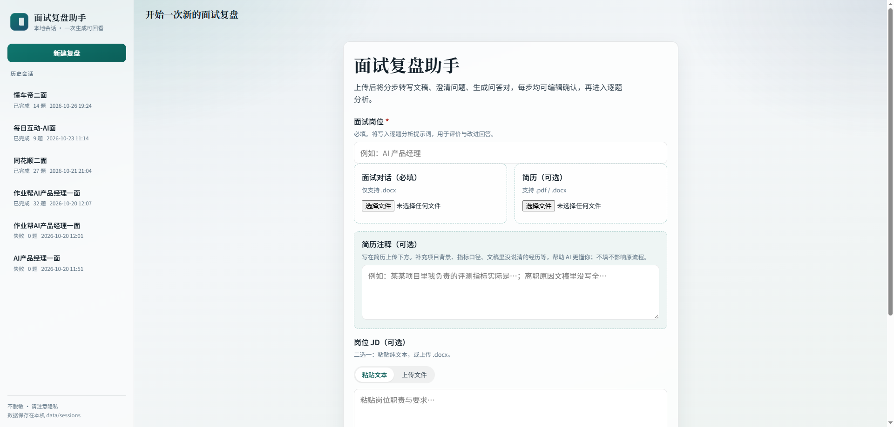
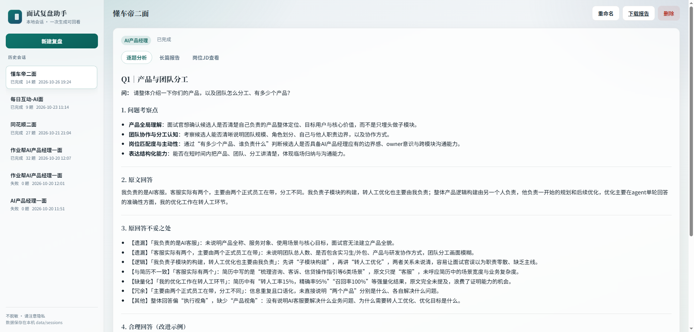

# 面试复盘助手

把一场面试的对话记录整理成可核对的问答，再按目标岗位逐题指出回答问题，并给出一份可参考的改进回答。整个过程在本机完成：上传一次，结果保存在本地，之后打开历史会话即可回看，不会再次调用模型。

适合已经结束的面试复盘。你提供面试对话，可选附上简历、简历注释和岗位 JD。助手先把口语化文稿整理清楚，再结合岗位要求分析每一题。

## 界面

新建复盘时填写岗位、面试对话，以及可选的简历、注释和岗位 JD。



分析完成后可以按题查看考察点、原文回答、不妥之处和改进回答，也可以切换到复盘报告或岗位 JD。



## 你能得到什么

- **转写文稿**：把对话整理成可读文本，便于核对事实。
- **问题列表**：抽出面试官问了什么，并带上必要背景。
- **问答对**：整理成「问 / 答」markdown（`interview_qa.md`）。
- **逐题分析**：每题四段——考察点、原文回答、不妥之处、改进回答。
- **复盘报告**：汇总成一份 `interview_review.md`，可在页面查看或下载。

逐题分析的四段分别是：

1. **问题考察点**：这道题在看什么能力、动机或一致性。
2. **原文回答**：保留整理后的原回答，不改写。
3. **原回答不妥之处**：按遗漏、逻辑、与简历不一致、冗余、缺量化等类型指出问题。
4. **合理回答（改进示例）**：以你的原文和简历为骨架，贴合目标岗位补全结构和量化，给出一份可参考的高分回答。

改进回答会优先使用简历、简历注释和原文里已有的项目与数据。简历或原文里没有的维度，只会做与岗位口径一致的有限补全，不会另编一段无关履历。

## 环境要求

- Python 3.10 及以上
- 可访问的大模型接口。默认使用 [DeepSeek](https://api.deepseek.com) 的 OpenAI 兼容接口
- 一份 API Key。仓库里的 Key 保持为空，只在你自己的电脑上填写

## 配置方法

配置集中在项目根目录的 `.env`，模板是 `.env.example`。程序启动时读取 `.env`，也会读取同名的系统环境变量。Windows 上如果只设置了用户或系统环境变量、当前终端还没刷新，程序会自行从注册表补读。

### 1. 安装依赖

在项目根目录执行：

```bash
pip install -r requirements.txt
```

### 2. 填写 API Key

复制模板：

```bash
copy .env.example .env
```

打开 `.env`，只在本地填写 Key：

```env
interview=你的DeepSeek_API_Key
```

`interview` 是 API Key 的变量名。仓库和 `.env.example` 里这一项是空的。`.env` 已被忽略，不要提交，也不要把真实 Key 写回仓库。

也可以不建 `.env`，改为在系统环境变量里设置 `interview`。两者都有值时，以进程里已经存在的环境变量为准。

### 3. 模型与生成参数

不改这些项也能运行。默认地址是 `https://api.deepseek.com`。

| 变量 | 默认值 | 作用 |
|------|--------|------|
| `LLM_BASE_URL` | `https://api.deepseek.com` | 接口地址，需兼容 OpenAI Chat Completions |
| `LLM_MODEL` | `deepseek-v4-pro` | 未单独指定阶段时的模型 |
| `LLM_TEMPERATURE` | `0.2` | 生成温度。思考模式开启时该参数不生效 |
| `LLM_MAX_TOKENS` | `15000` | 单次最大输出长度 |
| `LLM_TIMEOUT` | `180` | 单次请求超时（秒） |
| `LLM_MAX_RETRIES` | `3` | 失败重试次数 |
| `LLM_THINKING` | `false` | 是否开启 DeepSeek 思考模式。开启后推理内容可能占满输出长度，导致正文为空 |
| `LLM_REASONING_EFFORT` | `high` | 思考力度 |

三个阶段可以单独换模型，不写则使用下表默认值：

| 阶段 | 做什么 | 模型变量 | 默认模型 |
|------|--------|----------|----------|
| 简历摘要 | 把简历收成结构化摘要 | `LLM_RESUME_MODEL` | `deepseek-flash` |
| 对话整理 | 转写、澄清问题、生成问答对 | `LLM_DIALOGUE_MODEL` | `deepseek-flash` |
| 逐题分析 | 按岗位评价并改写回答 | `LLM_ANALYSIS_MODEL` | `deepseek-v4-pro` |

每个阶段还可以用对应前缀覆盖温度、输出长度和思考开关，例如 `LLM_ANALYSIS_TEMPERATURE`、`LLM_ANALYSIS_MAX_TOKENS`、`LLM_ANALYSIS_THINKING`。完整模板见 `.env.example`。

### 4. 运行参数

| 变量 | 默认值 | 作用 |
|------|--------|------|
| `QA_ANALYSIS_CONCURRENCY` | `3` | 逐题分析并发数 |
| `PERSIST_INTERMEDIATE` | `true` | 是否额外把结果写到 `output/` |
| `OUTPUT_DIR` | `output` | 兼容输出目录 |
| `SESSIONS_DIR` | `data/sessions` | 历史会话目录 |
| `LOG_DIR` | `logs` | 日志目录 |
| `LOG_LEVEL` | `INFO` | 日志级别，排查问题时可改为 `DEBUG` |
| `LOG_MAX_BYTES` | `5242880` | 单个日志文件约 5MB 后滚动 |
| `LOG_BACKUP_COUNT` | `5` | 保留的历史日志份数 |

改完 `.env` 后重新运行 `python run_web.py`。启动时如果读到 Key，终端会打印 Key 的长度，不会打印 Key 本身。没读到 Key 时，页面仍能打开，但生成复盘会认证失败。

## 使用流程

推荐用本地页面。命令行适合已经准备好文件、不需要分步确认的场景。

### 启动页面

```bash
python run_web.py
```

浏览器打开 http://127.0.0.1:8000/ 。可选参数：

```bash
python run_web.py --port 8000 --no-browser
python run_web.py --reload
```

`--host` 默认是 `127.0.0.1`，只在本机访问。`--no-browser` 不自动打开浏览器。`--reload` 用于改代码后热重载。

### 新建一次复盘

点击「新建复盘」，按页面填写：

1. **面试岗位（必填）**。例如「AI 产品经理」。它会写进逐题分析，用来判断回答是否贴岗位。
2. **面试对话（必填）**。只支持 `.docx`。
3. **简历（可选）**。支持 `.pdf`、`.docx`。扫描版 PDF 如果提取不出足够文字，会明确报错，不会假装解析成功。
4. **简历注释（可选）**。补充文稿里没说清的项目背景、指标口径或经历细节。不填不影响流程；填写后，摘要和逐题分析会把它当作你补充的事实。
5. **岗位 JD（可选）**。粘贴纯文本，或上传一份 `.docx`，两种方式选一种。
6. **会话标题（可选）**。不填时按岗位和对话文件名生成。

然后点击「开始解析」。

### 分三步确认文稿

解析不会一次做到底。每一步都可以直接改文本，确认后再进入下一步。中途关掉页面也没关系，从左侧历史会话点回去会回到当前这一步。

1. **转写文稿**。核对对话大意。这一步只确认内容是否完整，细节可以在后面两步再改。确认后进入问题澄清。
2. **澄清问题**。核对面试官的问题，以及问题背景是否正确。确认后生成问答对。
3. **问答对**。核对「问 / 答」是否配对正确，重点看问题。确认后开始逐题分析。

### 查看逐题分析和报告

分析按题推送，页面上能看到已完成题数。分析过程中可以暂停，之后从同一会话继续，已完成的题不会重算。

完成后有三个视图：

- **逐题分析**：每一题的考察点、原文、问题和改进回答。
- **复盘报告**：汇总题数、岗位、问题类型，以及全部题目的分析。
- **岗位 JD**：查看这次上传的 JD；没上传时这里是空的。

顶部可以重命名、删除会话，或下载 `interview_review.md`。

历史会话保存在本机 `data/sessions/{会话ID}/`。再次打开只读本地文件，不会重新请求模型。

### 命令行

不经过三步确认，直接跑完整条流水线：

```bash
python main.py --dialogue path\to\dialogue.docx --resume path\to\resume.pdf --position "AI 产品经理"
python main.py --dialogue path\to\dialogue.docx --position "AI 产品经理" --jd path\to\jd.docx
python main.py --dialogue path\to\dialogue.docx --position "AI 产品经理" --jd-text "岗位职责……"
```

`--position` 必填。`--resume`、`--jd`、`--jd-text`、`--title` 可选。JD 文件支持 `.docx` 和 `.txt`。

查看已经生成的会话，不调用模型：

```bash
python main.py --list
python main.py --show <session_id>
```

`--no-persist` 不写入 `output/`。`--no-session` 不写入 `data/sessions/`。

## 文件格式

| 材料 | 是否必填 | 格式 |
|------|----------|------|
| 面试对话 | 必填 | `.docx` |
| 简历 | 可选 | `.pdf`、`.docx` |
| 岗位 JD | 可选 | 页面里粘贴文本，或上传 `.docx`；命令行还可传 `.txt` |
| 简历注释 | 可选 | 页面文本框 |
| 面试岗位 | 必填 | 一段岗位名称，最长 100 字 |

## 结果放在哪里

一次会话的主要文件：

| 文件 | 内容 |
|------|------|
| `cleaned_transcript.txt` | 确认后的转写文稿 |
| `clarified_questions.md` | 确认后的问题列表 |
| `interview_qa.md` | 问答对 |
| `interview_review.md` | 完整复盘报告 |
| `resume_summary.json` | 简历结构化摘要。未上传简历时没有这份文件 |
| `job_description.txt` | 岗位 JD。未提供时没有这份文件 |

`PERSIST_INTERMEDIATE=true` 时，报告和问答还会再写一份到 `output/{会话ID}/`。

日志在 `logs/`：

| 文件 | 内容 |
|------|------|
| `app.log` | 流水线进度、模型调用耗时、重试和业务错误 |
| `access.log` | 请求方法、路径、状态码和耗时 |

日志只记录 Key 的长度，不记录完整 Key，也不落盘完整提示词。

## 隐私

程序**不会**自动脱敏。简历、对话和 JD 会原样保存在本机 `data/sessions/`。这些目录、`output/`、`logs/` 和 `.env` 都已在 `.gitignore` 中排除，不要把它们提交到仓库。页面底部也会提示数据只存在本机。

## 开发者参考

提示词在 `prompts/`，模型配置在 `config/llm_config.py`。业务代码只调用这两处，改提示词或换模型时不用改流水线。

```
config/llm_config.py     模型与运行配置
prompts/                 各阶段提示词
web/                     本地页面
src/parsers/             从 PDF、DOCX 提取文本
src/pipeline/wizard.py   三步确认
src/pipeline/            逐题分析与报告组装
src/api/                 页面所调用的接口
data/sessions/           历史会话
run_web.py               启动页面
main.py                  命令行
```

页面使用的主要接口：

| 接口 | 说明 |
|------|------|
| `POST /api/v1/sessions/wizard/start` | 上传材料并生成转写稿 |
| `POST /api/v1/sessions/{id}/wizard/confirm-transcript` | 确认转写稿，生成问题列表 |
| `POST /api/v1/sessions/{id}/wizard/confirm-questions` | 确认问题，生成问答对 |
| `POST /api/v1/sessions/{id}/wizard/analyze/stream` | 按问答对逐题分析（SSE） |
| `POST /api/v1/sessions/{id}/wizard/analyze/pause` | 暂停逐题分析 |
| `POST /api/v1/sessions/{id}/wizard/analyze/resume` | 继续逐题分析 |
| `GET /api/v1/sessions` | 历史列表 |
| `GET /api/v1/sessions/{id}` | 打开会话，只读本地文件 |
| `PATCH /api/v1/sessions/{id}` | 重命名 |
| `DELETE /api/v1/sessions/{id}` | 删除 |

运行测试：

```bash
pip install pytest
pytest tests/ -q
```
